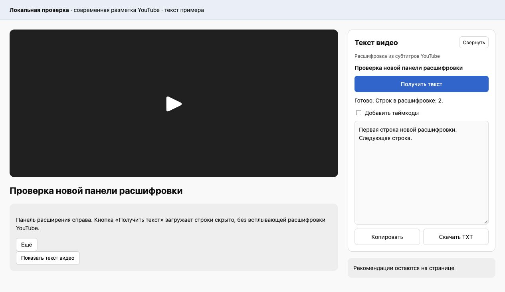

# Текст видео для YouTube

Расширение Chrome для копирования расшифровки YouTube и сохранения в TXT.
Панель «Текст видео» появляется на странице видео над рекомендациями.
Можно сохранить текст с таймкодами или без них.

Расширение использует готовые субтитры YouTube. Распознавания звука нет.
Сервер и API-ключи не нужны.



## Установка из GitHub

Для сборки нужны Node.js 24 или новее и npm. После установки расширения они не используются.

1. Скачайте репозиторий через **Code > Download ZIP** и распакуйте архив.
2. Откройте терминал в папке проекта и выполните:

   ```sh
   npm run package
   ```

3. Откройте `chrome://extensions` в Chrome.
4. Включите **Режим разработчика**.
5. Нажмите **Загрузить распакованное расширение** и выберите папку `dist` внутри проекта.
6. Перезагрузите открытые вкладки YouTube.

Папка `dist` создаётся при сборке и не хранится в Git. Выбирайте именно её,
а не корень проекта. Не перемещайте эту папку, пока расширение установлено в Chrome.
Устанавливать зависимости через `npm ci` для сборки не нужно.

## Использование

1. Откройте обычное видео YouTube и дождитесь загрузки страницы.
2. В панели **Текст видео** нажмите **Получить текст**.
3. При необходимости включите **Добавить таймкоды**.
4. Нажмите **Копировать** или **Скачать TXT**.

Расшифровка загружается через штатную панель YouTube. Расширение скрывает панель
на время загрузки и закрывает её после чтения. Если вы открыли её вручную до получения
текста, она остаётся видимой.

Панель расширения можно свернуть без потери результата. При смене видео или перезагрузке
вкладки текст сбрасывается. В узком окне панель может находиться под видео.

Получить текст можно и через значок расширения на панели Chrome. Это окно нужно
оставить открытым до конца загрузки. При закрытии окна результат не сохраняется.

## Обновление

1. Обновите исходники в той же папке и выполните `npm run package`.
2. В `chrome://extensions` нажмите кнопку перезагрузки на карточке расширения.
3. Перезагрузите вкладки YouTube.

## Ограничения

- Поддерживаются обычные страницы `/watch` на настольном YouTube.
  Shorts, встроенные плееры и мобильная версия не поддерживаются.
- Если YouTube не предоставляет расшифровку, получить текст не получится.
- Используется язык, выбранный в штатной панели расшифровки. Для смены языка
  выберите его на YouTube и получите текст повторно.
- Текст сохраняется без перевода и исправления ошибок. Повторяющиеся строки остаются.
- Изменения разметки YouTube могут нарушить работу расширения.
  Оно не обходит ограничения доступа к видео или требования входа в аккаунт.

## Доступ к данным

Расширение работает только на `youtube.com` и `www.youtube.com`. Оно читает заголовок
видео и расшифровку на странице. Текст извлекается после нажатия **Получить текст**.
Разрешения `activeTab` и `scripting` нужны для работы окна по значку расширения.

Текст не отправляется на сторонние серверы. Расширение не читает cookies,
не хранит историю и не использует аналитику. При загрузке расшифровки YouTube
выполняет свои обычные сетевые запросы. TXT сохраняется на устройство по нажатию пользователя.

## Разработка

Проект написан на JavaScript, HTML и CSS. Зависимость jsdom используется только в тестах.

```sh
npm ci
npm test
npm run check
npm run package
```

После изменения исходников пересоберите `dist`, перезагрузите расширение
в `chrome://extensions` и обновите вкладку YouTube.

Тесты проверяют извлечение текста из старой и новой разметки, пропуск скрытых
расшифровок, смену видео, ошибки загрузки, копирование и подготовку TXT.
Есть проверка готового скрипта из `dist`.
Автотесты используют локальные примеры страниц и имитацию Chrome API.

Перед публикацией проверьте расширение в Chrome:

1. Сравните начало и конец полученного текста со штатной расшифровкой YouTube.
2. Проверьте копирование и скачивание TXT с таймкодами и без них, включая русский текст.
3. Получите текст при закрытой и заранее открытой штатной панели расшифровки.
   Во втором случае панель должна остаться открытой.
4. Перейдите к другому видео во время загрузки. Старый текст не должен появиться.
5. Откройте видео без расшифровки, главную страницу и Shorts.
   Проверьте сообщения об ошибках, тёмную тему и узкое окно.

Актуальная разметка YouTube и фактическое сохранение файла в Chrome требуют
проверки в браузере.
